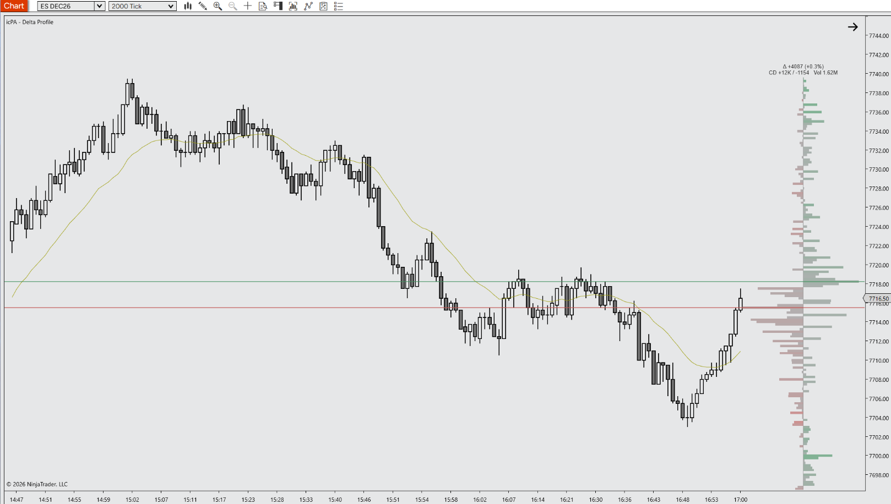

# icPA - Delta Profile for NinjaTrader 8

A specialized Indicator engineered for Price Action and Order Flow trading. It draws a delta profile for each session or anchored time window, with buying pressure to the right of a central axis and selling pressure to the left at every price, plus lines at the prices where buyers and sellers were most aggressive.

---

## 📺 Video Walkthrough & Setup

Watch the complete breakdown of parameters, price action context, and chart examples on YouTube:

> **[▶ Click here to watch the full YouTube walkthrough](https://youtube.com/@icPriceAction)**

---

## ☕ Support the Project

All tools by **icPriceAction** are **100% free and open-source for personal trading use**. There are no paywalls, subscriptions, or locked features and there never will be!

Developing, optimizing for zero latency on multiple charts/instruments, and maintaining documentation and releases takes a **considerable amount of personal time and ongoing effort**. 

If this tool saves you screen time, improves your execution, or cleans up your charts, buying a coffee is the best way to support continued development:

  

> **[☕ Support Development on Buy Me a Coffee](https://buymeacoffee.com/icpriceaction)**

---

## ⚡ Key Features

- **Diverging Delta Profile:** Net delta (buy volume minus sell volume) at every price, drawn from a central zero axis. Trades are classified by aggressor using bid/ask, with a tick-rule fallback, from the indicator's own 1-tick data series. No Tick Replay needed.
- **Delta Extreme Levels:** Lines at each profile's largest positive and largest negative delta, optionally extended to the right edge of the chart or through the next session. A summary label shows net delta, delta %, cumulative delta high/low and total volume.
- **Session or Anchored Profiles:** One profile per trading session, or per daily time window (e.g. 09:30–16:00 New York) in any time zone, with daylight saving handled automatically. The developing profile sits just right of the current bar so it stays next to price.
- **PATS & Context Aligned:** Designed for Price Action principles and disciplined futures execution.
- **Zero Chart Lag:** Native C# execution optimized to prevent UI freezes on high-frequency tick charts.
- **Clean Visuals:** Complementary default palette that preserves candlestick clarity without chart clutter.
- **Fully Customizable:** Configure colors, row sizing, widths, levels and text via the native NT8 settings panel.

---

## ⚠️ Prerequisites & Data Requirements

- **Tick Replay is not required.** The indicator loads its own 1-tick data series in the background.
- **Historical tick data is required** from your data provider for the days loaded on the chart. Without it, profiles build from realtime data only (a warning is printed to the Output window). Loading many days of tick data increases load time and memory use.
- **Bid/Ask classification** needs historical bid/ask quotes stored with the tick data. If your provider doesn't supply them, historical profiles fall back to the tick rule (up-tick / down-tick) and a one-time warning is printed. Realtime trades always use live quotes.
- **Calculate:** On each tick (the default). Other modes delay realtime updates; a warning is printed if it is changed.
- **Works on any bar type and timeframe.** Session profiles follow the chart's trading hours template.

---

## 📥 Installation Guide

1. Head to the **[Releases](https://github.com/icPriceAction/delta-profile/releases)** tab of this repository.
2. Download the latest release `.zip` file.
   - *Note: Do NOT extract or unzip the file.*
3. Open **NinjaTrader 8**.
4. In the Control Center, navigate to:
   `Tools` ➔ `Import` ➔ `NinjaScript Add-On...`
5. Select the downloaded `.zip` file and click **Open**.
6. A success dialog will appear confirming the tool has been imported.
7. Open any chart, press `Ctrl + I`, find **icPA - Delta Profile** in the **icPA** folder, and add it.

---

## ⚙️ Parameters & Configuration

| Parameter | Group | Type | Default | Description |
| :--- | :--- | :--- | :--- | :--- |
| Classification | 1. General | BidAsk / TickRule | BidAsk | BidAsk: trades at or above the ask are buys, at or below the bid are sells (tick rule inside the spread or when no quote exists). TickRule: up-tick / down-tick only. |
| Profile Scope | 1. General | Session / Anchored | Session | Session: one profile per trading session. Anchored: one profile per daily window starting at the anchor time. |
| Anchor Start Time | 1. General | Time | 09:30 | Anchored mode: time each profile starts, in the Anchor Time Zone. |
| Use Anchor End Time | 1. General | Bool | False | Anchored mode: stop the profile at the end time. If off, it runs until the next anchor. |
| Anchor End Time | 1. General | Time | 16:00 | Anchored mode: time each profile ends. An end time earlier than the start crosses midnight. |
| Anchor Time Zone | 1. General | Time zone | Eastern Standard Time | Time zone the anchor times are expressed in. Daylight saving is handled automatically. |
| Sessions To Keep | 1. General | Integer (1–500) | 10 | Maximum number of profiles kept in memory and drawn. |
| Show Diagnostics | 1. General | Bool | False | Prints per-period volume checks, delta levels and bid/ask coverage to the NinjaScript Output window. |
| Delta Measure | 2. Visuals | Absolute / Ratio | Absolute | Absolute: bar length is net delta in contracts. Ratio: bar length is delta ÷ volume at that price (100% = completely one-sided). |
| Width Scaling | 2. Visuals | PerSession / SharedVisible | PerSession | Absolute measure only. PerSession: each profile scaled to its own largest delta. SharedVisible: all visible profiles share one scale for comparison. |
| Completed Position | 2. Visuals | Start / Center / End | End | Where completed profiles sit within their session. When zoomed in, the profile slides to stay inside the visible part of its session. |
| Developing Position | 2. Visuals | RightOfCurrentBar / WithSession | RightOfCurrentBar | RightOfCurrentBar: fixed-width profile just right of the current bar. WithSession: placed over the session's bars like completed profiles. |
| Auto Right Margin | 2. Visuals | Bool | True | Raises the chart's right margin if it is too small for the developing profile (never reduces it). Restored when the indicator is removed. |
| Show Axis | 2. Visuals | Bool | True | Draws a thin zero-delta axis line through each profile. |
| Show Volume Context | 2. Visuals | Bool | False | Draws a faint volume silhouette, centred on the axis, behind the delta bars. |
| Show Delta Extremes | 2. Visuals | Bool | True | Lines at the prices with the largest positive and largest negative delta in each profile. |
| +Delta Extreme Line | 2. Visuals | Stroke | #3C8D5A, solid, 2 px, 70% | Line style for the price with the largest positive delta. |
| -Delta Extreme Line | 2. Visuals | Stroke | #C0504D, solid, 2 px, 70% | Line style for the price with the largest negative delta. |
| Extend Levels | 2. Visuals | None / ToRightEdge / ThroughNextSession | None | How far completed profiles' level lines extend. |
| Row Text | 2. Visuals | None / Delta / DeltaPercent / SellXBuy | None | Text on each row, on the opposite side of the axis from its bar. Hidden automatically when rows are too small. |
| Summary | 2. Visuals | None / Top / Bottom | Top | Per-profile summary (net delta, delta %, cumulative delta high/low, volume) above or below the profile. |
| Font | 2. Visuals | Font | Arial 10 | Font for row text and the summary label. |
| Text Color | 2. Visuals | Brush | #333333 | Colour of row text and the summary label. |
| Color Mode | 2. Visuals | Gradient / Solid | Gradient | Gradient: colour intensity follows the delta ratio (\|delta\| ÷ volume). Solid: full buy / sell colour. |
| Buy / Positive Delta | 2. Visuals | Brush | #3C8D5A | Colour of positive delta bars. |
| Sell / Negative Delta | 2. Visuals | Brush | #C0504D | Colour of negative delta bars. |
| Neutral / Axis | 2. Visuals | Brush | #8C8C8C | Colour for near-zero delta (gradient start) and the axis line. |
| Volume Context Color | 2. Visuals | Brush | #9AA3AD | Colour of the volume silhouette. |
| Profile Opacity (%) | 2. Visuals | Integer (0–100) | 60 | Opacity of the delta bars and axis. |
| Volume Context Opacity (%) | 2. Visuals | Integer (0–100) | 15 | Opacity of the volume silhouette. |
| Row Sizing | 3. Offsets & Thresholds | Auto / Manual | Auto | Auto: rows grouped to stay at least Min Row Height pixels tall. Manual: fixed Tick Grouping. |
| Min Row Height (px) | 3. Offsets & Thresholds | Integer (1–50) | 4 | Auto row sizing: minimum height of each row in pixels. |
| Tick Grouping | 3. Offsets & Thresholds | Integer (1+) | 1 | Ticks per row in Manual mode; minimum ticks per row in Auto mode. |
| Profile Width (%) | 3. Offsets & Thresholds | Integer (5–100) | 80 | Completed profiles: total width as a percentage of the session's width. |
| Max Profile Width (px) | 3. Offsets & Thresholds | Integer (20–2000) | 300 | Completed profiles: maximum total width in pixels. |
| Developing Width (px) | 3. Offsets & Thresholds | Integer (40–1000) | 280 | RightOfCurrentBar: total width of the developing profile in pixels. |
| Gradient Saturation (%) | 3. Offsets & Thresholds | Integer (5–100) | 20 | Delta ratio at which a row reaches full colour. Lower = more vivid. |

**For strategy developers:** the indicator exposes four plots (transparent by default): Period Delta, Period Volume, and the developing +/− delta extreme prices. It also has public accessors (`TryGetDeltaLevels`, `GetPeriodDelta`, `GetPeriodVolume`, `GetMaxPositiveDeltaPrice`, `GetMaxNegativeDeltaPrice`) that take a `periodsAgo` argument (0 = developing profile). Call them from `OnBarUpdate`.

---

## 📝 Changelog

- **v2.0.1** - Initial public release. Cleaned and optimized by icPriceAction.
- **v2.0.0** - Renamed from CustomVolumeDelta to CustomDeltaProfile; brushes frozen at Configure; realtime bid/ask snapshot discarded after every trade; Auto Right Margin guarded against the chart closing; chart label shows the indicator name only.
- **v1.9.1** - Developing profile (Right of current bar) stays pinned to the right edge of the screen when scrolling left.
- **v1.9.0** - Added Completed Position (Start / Center / End) for completed profiles.
- **v1.8.1** - Developing profile default width changed from 200 to 280 px.
- **v1.8.0** - Removed POC / Value Area; developing profile right of the current bar; Auto Right Margin; completed profile width as % of session with a pixel cap; two-line summary label.
- **v1.7.0** - Delta-first refocus: diverging delta bars, Absolute / Ratio measure, delta extreme levels, plots and accessors, optional volume context.
- **v1.6.2** - Level lines, row text, summary label, plots and public accessors (covers v1.6.0 - v1.6.2).
- **v1.5.0** - Rendering: one profile per period, auto row sizing, gradient colouring, width scaling, panel clipping and culling.
- **v1.4.0** - Data engine: 1-tick series, bid/ask classification with tick-rule fallback, session / anchored scope, Sessions To Keep, diagnostics.
- **v1.3.0** - Level 1 up-tick / down-tick profile built on the primary series.

---

## 🐛 Bug Reports & Feature Requests

Found an issue or have an enhancement idea?
Please submit an issue on the [Issues tab](https://github.com/icPriceAction/delta-profile/issues).

---

## License

Free for personal trading use. Commercial resale, redistribution, or repackaging is strictly prohibited. See [LICENSE](LICENSE).

---

## ⚖️ Disclaimer

Futures trading involves substantial risk of loss and is not suitable for every investor. All indicators, drawing tools, strategies, and documentation provided by **icPriceAction** are for educational and analytical purposes only. Nothing herein constitutes financial or investment advice. Automated strategies can lose money and may behave differently in live markets than in simulation or backtests.

NinjaTrader® is a registered trademark of NinjaTrader, LLC. icPriceAction is an independent developer with no official affiliation to NinjaTrader, LLC.